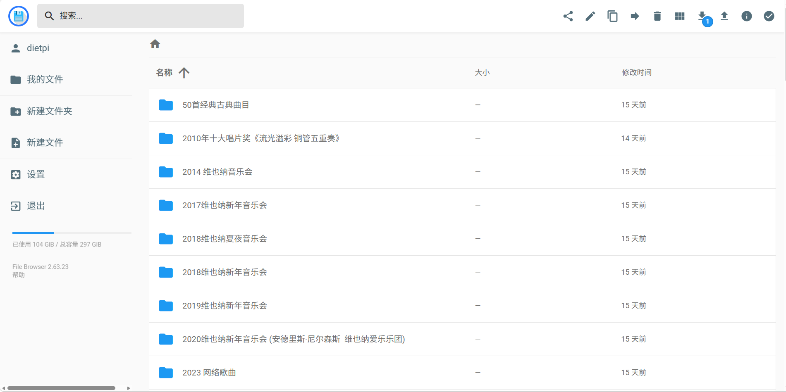

# DietPi 手动部署 File Browser (x86_64)


## 📖 项目简介

在 DietPi 上使用 `dietpi-software install 198` 安装 File Browser 时，由于脚本请求 GitHub API 检测最新版本时会被拦截（返回 403 错误），导致安装失败。

此外，File Browser 官方项目已于 2026 年 9 月归档（Archived），不再提供安全更新。但作为轻量级的本地 Web 文件管理器，它依然非常适合用来管理个人服务器上的特定目录（如音乐库 `/music`）。

本指南记录了在 **x86_64 (amd64)** 架构的 DietPi 上，手动下载、部署并配置 File Browser 作为 Systemd 后台服务的完整过程。

## 🛠️ 部署步骤

### 1. 手动下载二进制包

由于官方脚本请求会触发 403 错误，我们需要手动下载最后一个可用版本 `v2.63.23` 的 amd64 包。通过添加 `-A "Mozilla/5.0"` 伪装请求头，绕过 GitHub 的拦截。

```bash
cd /tmp
curl -L -A "Mozilla/5.0" https://github.com/filebrowser/filebrowser/releases/download/v2.63.23/linux-amd64-filebrowser.tar.gz -o linux-amd64-filebrowser.tar.gz
```

### 2. 解压与目录准备

创建安装目录和数据存放目录：

```bash
# 建立安装目录并解压
sudo mkdir -p /opt/filebrowser
sudo tar -xzf /tmp/linux-amd64-filebrowser.tar.gz -C /opt/filebrowser

# 建立数据存放目录
sudo mkdir -p /mnt/dietpi_userdata/filebrowser
```

### 3. 初始化配置与权限绑定

初始化数据库，并将网页的管理根目录限定在 `/music`（避免暴露整个系统文件），同时监听 8084 端口：

```bash
# 初始化数据库文件
sudo /opt/filebrowser/filebrowser config init -d /mnt/dietpi_userdata/filebrowser/filebrowser.db

# 限制根目录为 /music
sudo /opt/filebrowser/filebrowser config set -d /mnt/dietpi_userdata/filebrowser/filebrowser.db -r /music

# 设置监听地址 (0.0.0.0 表示允许局域网访问) 和端口
sudo /opt/filebrowser/filebrowser config set -d /mnt/dietpi_userdata/filebrowser/filebrowser.db -a 0.0.0.0 -p 8084
```

### 4. 创建登录账号

创建一个管理员账号（请将 `YourStrongPassword` 替换为你自己的密码，建议使用纯字母数字，避免特殊字符触发旧版 Bug）：

```bash
sudo /opt/filebrowser/filebrowser users add dietpi YourStrongPassword --perm.admin -d /mnt/dietpi_userdata/filebrowser/filebrowser.db
```

### 5. 配置 Systemd 后台服务

创建服务文件使其开机自启并在后台运行：

```bash
sudo nano /etc/systemd/system/filebrowser.service
```

粘贴以下内容：

```ini
[Unit]
Description=File Browser
After=network.target

[Service]
User=root
ExecStart=/opt/filebrowser/filebrowser -d /mnt/dietpi_userdata/filebrowser/filebrowser.db
Restart=on-failure

[Install]
WantedBy=multi-user.target
```

保存并退出（Ctrl+O -> Enter -> Ctrl+X）。

### 6. 启动服务

重新加载 systemd 并启动服务：

```bash
sudo systemctl daemon-reload
sudo systemctl enable --now filebrowser
```

## 🌐 验证与使用

打开浏览器，访问 `http://<你的DietPi_IP>:8084`。

- Username: `dietpi`
- Password: 你在第 4 步设置的密码。

**界面示例**（`/music` 曲库目录）：



## 🚑 已知问题与排错 (Troubleshooting)

<details>
<summary><b>点击展开：登录提示 "You have been logged out due to inactivity"</b></summary>

问题描述：这是 File Browser 旧版本的一个已知 Bug。输入正确密码后，前端未能正确保存会话状态，反而报错超时。

解决方法：调长 Token 的过期时间（例如设为 30 天 = 720h），可以强制覆盖该 Bug：

```bash
sudo systemctl stop filebrowser
sudo /opt/filebrowser/filebrowser config set -d /mnt/dietpi_userdata/filebrowser/filebrowser.db --tokenExpirationTime "720h"
sudo systemctl start filebrowser
```

</details>

> [!WARNING]
> 注意事项：
>
> - 该项目已停止维护，建议仅在内网使用，不要直接暴露到公网。
> - DietPi 自动安装脚本（ID: 198）在遇到网络问题时可能会误停其他服务（如 lyrionmusicserver），如果使用脚本安装失败，请记得手动重启受影响的服务。
